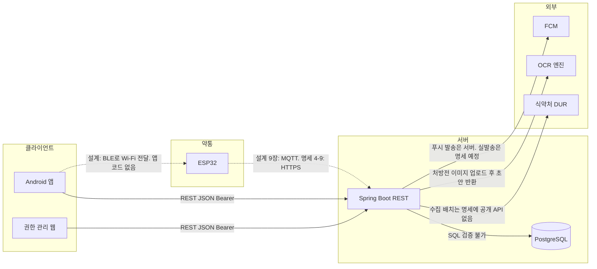

# 7. 인터페이스 및 API 명세

문서 버전: 2026-11-01 개정. 백엔드 담당자가 코드를 확인하고 확정한 답변이 v0.9 예시보다 우선한다. 배포일은 적지 않는다. 통합 현황은 `api-integration-master-status.md`를 본다.

이 장은 약연 서버 API 명세서 v0.9(기준일 2026-10-29)를 기준으로 하되, 아래 확정과 충돌하면 확정을 따른다.

- `dur_seq`는 string이다. VARCHAR(20). 숫자로 바꾸지 않는다.
- `groups`는 null이 아닌 배열이다. 병용금기가 없으면 `[]`. 원소 그룹은 약 2개 이상이다. 예: `{"groups":[[1,3],[5,7,8]]}`.
- `summary.flagged`는 병용금기 약 쌍 수가 아니라 표시되는 병용금기 건수다. `edges`와 `interactions`와 개수가 같다. `summary.total`은 오늘 복용 중인 약만이라 `nodes`보다 작을 수 있다. `summary.unchecked`는 `nodes` 중 `checked=false` 개수와 같다.
- 홈 슬롯 `state`는 `NONE`/`PENDING`/`DONE`/`MISSED`다. 예시의 `ACTIVE`와 `NORMAL`은 슬롯 값이 아니다. `next_dose.status`는 `PENDING`이고, 다음 복약이 없으면 `next_dose`는 null이되 필드는 있다.
- 칸 배정 직후 `status`는 `PENDING_LOAD`다. `loaded_count`와 `remaining_count`는 null, `low_stock`은 false, `valid_from`과 `valid_to`는 null이다. 충전 5개면 `ACTIVE`, `loaded_count` 5, `remaining_count` 5, `valid_from`은 충전 시각, `valid_to`는 null이다. 추가 충전은 누적 `loaded_count`와 남은 `remaining_count`를 따로 둔다.
- `attention`과 `schedule_in_sync`는 현재 서버에 없다. 없으면 파싱 오류로 보지 않고, 없는 `schedule_in_sync`를 true로 두지 않는다.
- 약통 API는 보호자에게 `DEVICE_EVENT`가 필요하다. 쓰기는 `READ_WRITE`도 필요하다. 병용금기 요약·그래프·목록은 `DUR_INFO`가 필요하다. 병용금기 상세는 환자 번호 없이 로그인만 필요하다.
- 약 등록의 `403 CONSENT_REQUIRED`는 아직 서버에 없다. 동의 없이 201이 나올 수 있다. 앱의 사전 동의 확인은 유지한다.
- `BEDTIME`은 아직 서버가 거절한다. 앱은 보내지 않는다. 순서는 나중에 `MORNING`, `LUNCH`, `DINNER`, `BEDTIME`이다.
- 약통 등록은 QR 스캔이 아니다. `serial_no`와 `secret`을 직접 넣어 `POST /patients/{id}/device`에 보낸다. `secret`은 로그에 남기지 않는다.
- 보호자는 복약자 선택 화면 없이 `managed-patients`의 첫 복약자를 쓴다. 정렬은 서버가 `SELF` 다음 연동 시각 빠른 순으로 보장한다.
- `GET/POST /users/me/agreements`와 철회 API는 아직 없다. `GET /terms`는 있다. 개발 DB에 `MEDICATION` 약관 시드는 없다.
- `GET share-summary`, `POST /guardian-links/grant`, `PATCH shared-items`, `managed-patients.shared_items`는 아직 없다. `medication_ids`는 보내지 않는다.

아래 본문은 약연 서버 API 명세서 v0.9(기준일 2026-10-29)와 2026-10-31 코드 대조를 유지한다. 맨 위 2026-11-01 확정과 다르면 확정을 따른다. 상세설계서 3장·4장의 요구사항과 연결하고, Android 앱(`yakyeon-frontend-rebuild`)과 복약자 권한 관리 웹 두 벌을 코드와 대조했다. 서버 소스, PostgreSQL 스키마, ESP32 펌웨어, MQTT 브로커 설정은 이번 조사에서 확인하지 못했다. 따라서 「명세에 정의됨」과 「화면에서 호출함」과 「실서버로 검증함」을 같은 뜻으로 쓰지 않는다.

구현 상태 열의 뜻은 다음과 같다.

| 표기 | 뜻 |
| --- | --- |
| 명세 ✅ | v0.9 2부. 명세가 서버 코드에서 읽었다고 한 API |
| 명세 🔜 | v0.9 4부. 계약은 확정, 서버에 없으면 호출 시 404 |
| 화면 호출 | 앱 또는 권한 웹의 화면 동작이 해당 경로를 호출 |
| 메서드만 | 호출 함수는 있으나 화면이 호출하지 않음 |
| 미호출 | 확인한 앱·웹 코드에 해당 경로 없음 |
| 실연동 검증 없음 | 이번 조사에서 실제 서버 응답을 확인하지 않음. 아래 API 공통 |

로그인하지 않은 앱의 홈·그래프·약통은 로컬 데모이며 서버 인터페이스가 아니다.

필드 이름, 필수 여부, 자료형은 v0.9에 있는 것만 적는다. 명세에 없는 필드는 추가하지 않는다. 관련 DB는 8장 테이블 이름과의 대응 후보이며, 4장과 8장의 이름이 다른 경우는 확정하지 않고 「8장 후보, 스키마 확인 필요」로 둔다.

## 7.1 인터페이스 구성

약연은 Android 앱, 복약자 권한 관리 웹, Spring Boot API, PostgreSQL, 식약처 DUR, OCR, FCM, ESP32 약통으로 구성된다. 앱과 웹은 서버와 HTTPS REST JSON으로 통신한다. 개발 Base URL은 `http://localhost:8080`이고, 경로에 `/api/v1` 같은 버전 접두어는 명세에 없다. 배포 URL은 미정이다.

약통의 통신은 문서 사이에 차이가 있다. 9장은 Eclipse Mosquitto를 거치는 MQTT(`yakyeon/{serial_no}/메시지`)로 적는다. v0.9 4-9는 기기 통신을 HTTPS로 확정하고, MQTT로 바꾸는 작업은 하드웨어 입고 뒤의 별도 명세로 남긴다. 펌웨어가 없어 현재 구현이 어느 쪽인지는 검증 불가이다. 이 장은 두 계약을 함께 적고, 앱이 호출하는 약통 API는 v0.9를 따른다.

| 인터페이스 | 송신 | 수신 | 통신 방식 | 주요 데이터 | 구현 상태 |
| --- | --- | --- | --- | --- | --- |
| 앱 ↔ API | Android | Spring Boot | HTTP JSON. 처방전만 multipart. `Authorization: Bearer` | 인증, 처방, 일정, 병용금기, 약통 화면, 알림 설정, 공유 요약 | 화면 호출 46개. 실연동 검증 없음. 클라이언트는 `ApiClient`(`HttpURLConnection`) |
| 웹 ↔ API | 권한 관리 웹 | Spring Boot | HTTP JSON. Bearer | 가입, 로그인, 열람 허용, 범위 변경, 해제 | `yakyeon-consent-web`이 13개 경로를 호출. 토큰은 메모리. 시제품 `Capstone-FRONT-END-WEB`은 `localStorage`만 사용하고 HTTP가 없음. 실연동 검증 없음 |
| API ↔ DB | Spring Boot | PostgreSQL | SQL | 8장 테이블 | 서버 소스 없음. 검증 불가 |
| API ↔ DUR | 서버 주기 작업 | 공공데이터 | 설계서의 외부 연계. 앱에 수집 API 없음 | 병용금기 원본과 성분 쌍 | 검증 불가. 앱은 결과 조회 4개만 호출 |
| API ↔ OCR | 앱이 이미지를 API에 전달 | OCR 엔진 | `POST /prescriptions/ocr` | JPEG·PNG 최대 10MB. 응답은 초안. 원본은 저장하지 않음 | 앱 호출 있음. 명세는 현재 Mock. 업체 장애는 🔜 `503 OCR_UNAVAILABLE` |
| API ↔ FCM | 서버 | 단말 | FCM. 채널 ID `INTERACTION`, `INTAKE`, `DEVICE`, `STOCK` | `title`, `body`, `data.notification_id`만. 약 이름 없음 | 토큰 등록 메서드만 있고 화면 미호출. 실발송은 명세 예정. 앱 채널 생성은 미확인 |
| 앱 ↔ 약통 | Android | ESP32 | 등록은 시리얼 번호와 비밀값 직접 입력. QR·블루투스는 미확정 | `serial_no`, `secret` | 로그인 화면은 두 값을 `POST /patients/{id}/device`로 보낸다. `secret`은 로그에 남기지 않음 |
| 약통 ↔ 서버 | ESP32 | API 또는 브로커 | 9장 MQTT 8종 메시지. v0.9는 `POST /device/heartbeat`, `POST /device/signals`, 🔜 `GET /device/schedule` | 개방, 버튼, 일정 버전, 센서 상태 | 펌웨어 없음. 검증 불가 |

권한은 두 층이다. 첫째, 계정 권한 `READ_ONLY`와 `READ_WRITE`이다. 읽기 전용 보호자의 쓰기는 `403 INSUFFICIENT_PERMISSION`이다. 둘째, v0.9 4-1의 열람 항목이다. 보호자 호출에만 적용되며, 항목이 없으면 `403 SHARE_NOT_GRANTED`이다. 필수 3개(`PERSONAL_INFO`, `MED_INFO`, `PHOTO`)에 동의하면 연동은 `READ_WRITE`로 시작한다. 하나라도 거부하면 연동을 만들지 않고 `REJECTED`로 남긴다. 이 열람 항목 강제는 명세상 예정이다.

없는 번호와 권한 없는 번호는 구분하지 않고 `404`이다. 연동 해제 즉시 그 복약자 데이터와 이미 받은 알림이 같은 토큰으로도 보이지 않는다.

## 7.2 API 공통 규칙

| 항목 | 내용 | 근거 |
| --- | --- | --- |
| Base URL | 개발 `http://localhost:8080`. 웹 연동본은 `http://127.0.0.1:8080`. 배포 주소는 미정 | v0.9, `app/build.gradle.kts`, `yakyeon-consent-web/js/config.js` |
| URL 규칙 | 버전 접두어 없음. 자원 경로. 번호는 경로 변수 | v0.9. `/v1` 여부는 백엔드 확인 필요라고 단정하지 않고, 명세에 없다고 적음 |
| Method | GET, POST, PUT, PATCH, DELETE | v0.9 |
| Content-Type | `application/json`. 예외는 OCR `multipart/form-data` | v0.9 |
| 필드 이름 | snake_case. 없는 값은 `null`이거나 필드 생략. API마다 명세의 「존재」 열을 따른다 | v0.9 |
| 시각 | ISO-8601, 한국 시간 `+09:00`. 예외: `GET /users/me/consents`의 `occurred_at`만 UTC `Z` | v0.9 |
| 날짜 | `YYYY-MM-DD` | v0.9 |
| 번호 | 64비트 정수 | v0.9 |
| 인증 | `Authorization: Bearer <access_token>`. access 30분, refresh 14일, refresh는 1회용 | v0.9 |
| 갱신 | `401`이고 코드가 `UNAUTHENTICATED`이면 `POST /auth/refresh` 후 같은 요청을 한 번 재시도. 재사용은 `REFRESH_TOKEN_REUSED`이며 전체 로그인 해제 | v0.9. 앱 `ApiClient`, 웹 `http.js` |
| 토큰 저장 | 설계 4-2는 Keystore. 앱 구현은 `SharedPreferences`(`yakyeon_auth`). 웹 연동본은 메모리. 시제품 웹만 localStorage | 코드 대조. 설계와 불일치 |
| 권한 | 본인 또는 `ACTIVE` 보호자. 범위는 `READ_ONLY` / `READ_WRITE`. 열람 항목은 4-1 예정 | v0.9 |
| 목록 | `page`는 0부터, `size` 최대 100. 일정 기간 최대 31일, 기록·공유 최대 90일. 위반은 `400 INVALID_QUERY` | v0.9 |
| 오류 본문 | `{ "code", "message" }`. 화면 분기는 `code`. `message`는 바뀔 수 있음 | v0.9 |
| 검증 오류 | `400 VALIDATION_ERROR`. 현재는 자바 필드명이 메시지 앞에 붙을 수 있음. snake_case 통일은 🔜 4-10 | v0.9 |
| 공통 상태 | `400`, `401 UNAUTHENTICATED`, `403`, `404`, `409`, `429`, `500`. JSON이 아닌 5xx는 문구를 단정하지 않음 | v0.9 5부 |
| 개발 제약 | 문자는 콘솔 `[MOCK SMS]`. OCR은 Mock. 푸시는 저장만 되고 실발송은 예정. 시간대는 아침·점심·저녁만. 취침은 🔜 | v0.9 1-6 |

기기 전용 API는 `X-Device-Serial`, `X-Device-Secret`이다. 앱 Bearer와 다르다. 앱은 `/device/*`를 호출하지 않는다.

### 공통 오류 중 화면에서 자주 나누는 코드

| 코드 | HTTP | 언제 |
| --- | --- | --- |
| `VALIDATION_ERROR` | 400 | 필수값, 형식, 허용되지 않는 enum |
| `UNAUTHENTICATED` | 401 | 토큰 없음·만료·변조 |
| `INVALID_CREDENTIALS` | 401 | 로그인 실패. 아이디와 비밀번호를 구분하지 않음 |
| `INVALID_REFRESH_TOKEN` | 401 | 갱신 토큰 무효 |
| `REFRESH_TOKEN_REUSED` | 401 | 갱신 토큰 재사용. 전체 로그아웃 |
| `INSUFFICIENT_PERMISSION` | 403 | `READ_ONLY`의 쓰기 등 |
| `SHARE_NOT_GRANTED` | 403 | 🔜. 보호자가 공유되지 않은 항목을 요청 |
| `CONSENT_REQUIRED` | 403 | 🔜. 약물 등록은 `MEDICATION`, 약통 등록은 `DEVICE` 동의 필요 |
| `PATIENT_NOT_FOUND` 등 | 404 | 없음과 권한 없음을 구분하지 않음 |

전체 코드는 v0.9 5부와 4부 신규 코드(`GUARDIAN_NOT_FOUND`, `PATIENT_ONLY`, `REQUIRED_CONSENT_ITEM`, `RATE_LIMITED`, `OCR_UNAVAILABLE`)를 따른다. 이 장에 없는 코드는 명세 5부를 그대로 쓴다.

## 7.3 API 상세 명세

영역마다 목록을 두고, 그 영역의 대표 API만 필드 단위로 적는다. 목록에만 있는 API의 필드도 v0.9와 같으며, 여기서 필드를 줄이거나 바꾸지 않는다. 실연동 검증은 영역 전체 없음이다.

### 7.3.1 인증·회원가입·로그인

관련 요구사항: FR-AUTH-001, FR-AUTH-002, FR-AUTH-003, FR-MY-001, FR-MY-002.

| API | 기능 | Method | Endpoint | 인증 | 요구사항 | 구현 상태 |
| --- | --- | --- | --- | --- | --- | --- |
| AUTH-01 | 약관 조회 | GET | `/terms` | 없음 | FR-AUTH-003 | 명세 ✅. 앱·웹 화면 호출 |
| AUTH-02 | 인증번호 발송 | POST | `/auth/phone-verifications` | 없음 | FR-AUTH-001 | 명세 ✅. 앱·웹 화면 호출 |
| AUTH-03 | 인증번호 확인 | POST | `/auth/phone-verifications/{verificationId}/confirm` | 없음 | FR-AUTH-001 | 명세 ✅. 틀린 번호도 HTTP 200, `verified: false` |
| AUTH-04 | 아이디 중복 | GET | `/auth/check-id?login_id=` | 없음 | FR-AUTH-001 | 명세 ✅. 앱·웹 화면 호출 |
| AUTH-05 | 회원가입 | POST | `/auth/signup` | 없음 | FR-AUTH-001, FR-AUTH-003 | 명세 ✅. 입력 규칙 변경은 🔜 4-4 |
| AUTH-06 | 로그인 | POST | `/auth/login` | 없음 | FR-AUTH-002 | 명세 ✅. 앱·웹 화면 호출 |
| AUTH-07 | 토큰 갱신 | POST | `/auth/refresh` | 없음 | FR-AUTH-002 | 명세 ✅. 앱·웹이 401에서 호출 |
| AUTH-08 | 로그아웃 | POST | `/auth/logout` | 없음 | FR-AUTH-002 | 명세 ✅. refresh가 없으면 앱·웹은 서버를 호출하지 않음 |
| AUTH-09 | 비밀번호 변경 | PATCH | `/auth/password` | Bearer | FR-MY-001 | 명세 ✅. 앱 화면 호출. 성공 시 모든 세션 해제 |
| AUTH-10 | 회원 탈퇴 | DELETE | `/auth/account` | Bearer | FR-MY-002 | 명세 ✅. 앱 화면 호출 |
| AUTH-11 | 프로필 조회 | GET | `/users/me/profile` | Bearer | FR-MY-001 | 명세 ✅. 앱 화면 호출. 번호는 마스킹 |
| AUTH-12 | 이름 수정 | PATCH | `/users/me/profile` | Bearer | FR-MY-001 | 명세 ✅. `name`만. 다른 필드는 400 |
| AUTH-13 | 동의 이력 | GET | `/users/me/consents` | Bearer | FR-AUTH-005 | 명세 ✅. 앱·웹 미호출. `occurred_at`은 UTC |

휴대폰 번호·생년월일 변경 API는 만들지 않는다(v0.9 4-8). 화면은 읽기 전용이다. 로그인 잠금 횟수와 시간은 설계 4-2도 확정 필요로 두었고, 명세에 별도 필드가 없다. 백엔드 확인 필요.

**AUTH-05 회원가입**

| 구분 | 내용 |
| --- | --- |
| 기능 설명 | 문자 인증 증표와 약관 동의로 가입한다. `PATIENT`이면 복약자 프로필을 함께 만든다. 이메일은 받지 않는다 |
| HTTP Method | POST |
| Endpoint | `/auth/signup` |
| 인증 | 없음 |
| Request Header | `Content-Type: application/json` |
| Request Body | `login_id` string 필수. `password` string 필수. `password_confirm` string 필수. `account_type` string 필수 `PATIENT` 또는 `GUARDIAN`. `agreements[]` 필수. 원소는 `terms_version_id` number, `agreed` boolean. `name` string 필수. `birth_date` string `YYYY-MM-DD` 필수. `phone` string 필수, 숫자만. `verification_id` number 필수. `verification_token` string 필수 |
| Response Body | `201`. `user_id` number |
| 오류 코드 | `400 INVALID_PHONE_FORMAT`, `PASSWORD_MISMATCH`, `REQUIRED_TERMS_NOT_AGREED`, `VERIFICATION_NOT_COMPLETED`. `409 DUPLICATE_LOGIN_ID`, `DUPLICATE_PHONE`, `TERMS_VERSION_OUTDATED` |
| 관련 DB | 8장 후보 `app_user`, `patient`, `user_agreement`, `agreement_log`, `phone_verification`. 스키마 확인 필요 |
| 관련 요구사항 | FR-AUTH-001, FR-AUTH-003 |
| 구현 상태 | 명세 ✅. 현재 서버 규칙은 아이디 4~30자, 비밀번호 8~64자. 화면과 🔜 4-4는 아이디 6~20 영문·숫자, 비밀번호는 영문·숫자·특수문자 각 1자 이상. 앱은 화면 규칙으로 보내고 상한 64자를 둔다. 웹도 같은 API를 호출. 실연동 검증 없음 |

**AUTH-06 로그인**

| 구분 | 내용 |
| --- | --- |
| 기능 설명 | 아이디·비밀번호로 access 30분, refresh 14일을 발급한다 |
| HTTP Method | POST |
| Endpoint | `/auth/login` |
| 인증 | 없음 |
| Request Body | `login_id` string 필수. `password` string 필수 |
| Response Body | `200`. `access_token`, `refresh_token`, `token_type`(항상 `Bearer`), `expires_in` number, `user_id` number, `account_type` string |
| 오류 코드 | `401 INVALID_CREDENTIALS` |
| 관련 DB | 8장 후보 `app_user`, `auth_token` |
| 관련 요구사항 | FR-AUTH-002 |
| 구현 상태 | 명세 ✅. 앱·웹 화면 호출. 웹은 `account_type`이 `PATIENT`가 아니면 세션을 지운다. 실연동 검증 없음 |

**AUTH-07 토큰 갱신**

| 구분 | 내용 |
| --- | --- |
| 기능 설명 | refresh를 1회 사용하고 새 토큰 쌍을 받는다. 보낸 토큰은 즉시 무효 |
| HTTP Method | POST |
| Endpoint | `/auth/refresh` |
| 인증 | 없음. 본문의 refresh |
| Request Body | `refresh_token` string 필수 |
| Response Body | `200`. 로그인과 같은 필드 |
| 오류 코드 | `401 INVALID_REFRESH_TOKEN`, `REFRESH_TOKEN_REUSED` |
| 관련 DB | 8장 후보 `auth_token` |
| 관련 요구사항 | FR-AUTH-002 |
| 구현 상태 | 명세 ✅. 앱 `ApiClient.refreshSession`, 웹 `http.js`. 실연동 검증 없음 |

호출 순서(앱·웹 공통): `GET /terms` → 인증번호 발송 → 확인으로 `verification_token` → 아이디 중복은 선택 → `POST /auth/signup` → `POST /auth/login`. 앱은 로그인 직후 `PUT /users/me/push-token`을 명세대로 호출하지 않는다. FCM 토큰이 없다.

### 7.3.2 약관·개인정보 동의

관련 요구사항: FR-AUTH-003, FR-AUTH-006, FR-MY-003.

| API | 기능 | Method | Endpoint | 인증 | 요구사항 | 구현 상태 |
| --- | --- | --- | --- | --- | --- | --- |
| AGR-01 | 현재 동의 | GET | `/users/me/agreements` | Bearer | FR-AUTH-003, FR-AUTH-006 | 계약은 200 배열. 서버 미구현. 앱이 호출하면 404 |
| AGR-02 | 동의 저장 | POST | `/users/me/agreements` | Bearer | FR-AUTH-003 | 계약은 200과 현재 상태 한 건. 재동의도 200. 서버 미구현 |
| AGR-03 | 동의 철회 | POST | `/users/me/agreements/{termsType}/withdraw` | Bearer | FR-AUTH-006 | 계약은 204, 본문 없음. 서버 미구현. 복약 카드 버튼 둘은 `MEDICATION` |

약관 종류는 `TOS`, `PRIVACY`, `SENSITIVE_HEALTH`, `SERVICE_NOTICE`, `MEDICATION`, `DEVICE`이다. 가입 필수 4개는 이용약관, 개인정보, 민감정보, 서비스 이용 고지이다. `MEDICATION` 없이 처방 등록, `DEVICE` 없이 약통 등록은 `403 CONSENT_REQUIRED`(예정).

**AGR-02 동의 저장**

| 구분 | 내용 |
| --- | --- |
| 기능 설명 | 약 등록 또는 약통 등록 전에 해당 약관 버전에 동의한다. 이미 동의한 재전송도 성공으로 둔다 |
| HTTP Method | POST |
| Endpoint | `/users/me/agreements` |
| 인증 | Bearer |
| Request Body | `terms_version_id` number 필수. `agreed` boolean 필수 |
| Response Body | `200`. `terms_type`, `terms_version_id`, `version`, `agreed`, `changed_at`. 이미 동의한 재전송도 200 |
| 오류 코드 | 명세에 이 절 전용 표가 없다. 공통 `VALIDATION_ERROR`, `UNAUTHENTICATED` |
| 관련 DB | 8장 후보 `user_agreement`, `agreement_log`, `terms_version` |
| 관련 요구사항 | FR-AUTH-003 |
| 구현 상태 | 명세 🔜. 앱은 `terms_version_id`를 고정하지 않고 `GET /terms`의 해당 `terms_type` 값을 보낸다. 실연동 검증 없음 |

철회 효과(명세 확정, 서버 적용 여부는 검증 불가): `MEDICATION`은 등록·수정 불가, 조회는 가능. `DEVICE`는 등록 불가, 연결된 약통 해제. `TOS`, `PRIVACY`, `SENSITIVE_HEALTH`는 건강정보 API를 `403 CONSENT_REQUIRED`로 거절하고 로그인·갱신·약관·프로필 조회·탈퇴만 남긴다.

### 7.3.3 보호자 QR 연동·권한

관련 요구사항: FR-AUTH-004, FR-AUTH-005, FR-MULTI-001.

정식 흐름은 QR이다. QR 내용물은 웹 주소뿐이고, QR을 만드는 서버 API는 없다. 추가 API를 설계하지 않는다. 앱의 QR 이미지가 그 주소와 같은지는 코드만으로 확인하지 못했다. 리소스는 `care_qr_code`이다.

| API | 기능 | Method | Endpoint | 인증 | 요구사항 | 구현 상태 |
| --- | --- | --- | --- | --- | --- | --- |
| LNK-01 | 열람 허용 | POST | `/guardian-links/grant` | Bearer, `PATIENT` | FR-AUTH-004 | 명세 🔜. 웹 화면 호출. 앱은 호출하지 않음 |
| LNK-02 | 범위 변경 | PATCH | `/guardian-links/{linkId}/shared-items` | Bearer, 복약자 | FR-AUTH-005 | 명세 🔜. 웹 화면 호출 |
| LNK-03 | 연동 해제 | DELETE | `/guardian-links/{linkId}` | Bearer | FR-AUTH-005 | 명세 ✅. 앱·웹 화면 호출. `204` |
| LNK-04 | 권한 변경 | PATCH | `/guardian-links/{linkId}/permission` | Bearer | FR-AUTH-005 | 명세 ✅. 앱·웹 미호출. 보호자는 낮추기만 |
| LNK-05 | 보호자 목록 | GET | `/patients/{patientId}/guardian-links` | Bearer, 본인 | FR-AUTH-005 | 명세 ✅. 앱·웹 화면 호출 |
| LNK-06 | 관리 복약자 | GET | `/users/me/managed-patients` | Bearer | FR-MULTI-001 | 명세 ✅. 앱·웹 화면 호출. 여러 명 선택 화면은 없음 |
| LNK-07 | 복약자 조회 | GET | `/patients/{patientId}` | Bearer | FR-AUTH-005 | 명세 ✅. 앱·웹 미호출 |

문자 검색·연동 요청·위임 인증·`POST /guardian-links/{id}/consent`, 보호자의 `POST /patients`, `POST /revocations/request`, `POST /revocations/confirm`은 명세 ✅이나 곧 기본 꺼짐이다. 확인한 앱·웹은 호출하지 않는다. 화면에서도 쓰지 않는다.

**LNK-01 열람 허용**

| 구분 | 내용 |
| --- | --- |
| 기능 설명 | 복약자가 대리인 아이디와 열람 6항목을 보내 연동을 만든다. 필수 3개가 모두 동의하면 `READ_WRITE`. 하나라도 거짓이면 `REJECTED`이고 연동을 쓰지 못한다 |
| HTTP Method | POST |
| Endpoint | `/guardian-links/grant` |
| 인증 | Bearer. `PATIENT`만. 보호자 호출은 `403 PATIENT_ONLY` |
| Request Body | `guardian_login_id` string 필수. `relationship` string 선택, 20자 이하, 값 목록 검사 없음. `terms_version_id` number 필수, `GET /terms`의 `DELEGATION`. `consents` object 필수. 키 6개 모두 필요: `PERSONAL_INFO`, `MED_INFO`, `PHOTO`, `DOSE_RECORD`, `DEVICE_EVENT`, `DUR_INFO`. 값은 boolean |
| Response Body | `200`. 필수 3개 동의 시 `link_id`, `status`=`ACTIVE`, `permission_scope`=`READ_WRITE`, `shared_items` 배열. 필수 거부 시 `status`=`REJECTED`, `shared_items` 빈 배열 |
| 오류 코드 | `404 GUARDIAN_NOT_FOUND`(없는 아이디·보호자 아님·탈퇴를 구분하지 않음). `409 GUARDIAN_LINK_ALREADY_EXISTS`. `409 TERMS_VERSION_OUTDATED`. `429 RATE_LIMITED`(계정 시간당 10, IP 시간당 30). `400 VALIDATION_ERROR` |
| 관련 DB | 8장 후보 `guardian_link`, `consent_log`, `link_invite` |
| 관련 요구사항 | FR-AUTH-004 |
| 구현 상태 | 명세 🔜. 웹 `grantLink`. 실연동 검증 없음. 서버에 없으면 404 |

열람 항목과 보호자 API(명세 4-1, 보호자 호출에만):

| 항목 | 필요한 API |
| --- | --- |
| `PERSONAL_INFO` | `GET /patients/{id}` |
| `MED_INFO` | 약·처방 조회와 등록·수정·삭제·종료 |
| `DOSE_RECORD` | 일정, 기록, 홈 요약, 먹었어요, 안 먹었어요, 복용 시각 |
| `DUR_INFO` | 병용금기 목록·요약·그래프. 상세는 공개 참고라 이 권한이 필요 없다 |
| `DEVICE_EVENT` | 약통 등록·해제·조회, 칸 배정·해제, load, refill, device/sync, device/settings. 쓰기는 `READ_WRITE`도 필요 |
| `PHOTO` | 서버가 사진을 보관하지 않음. 접근 제한 대상 없음 |

범위 변경에서 필수 3개를 거짓으로 바꾸면 `400 REQUIRED_CONSENT_ITEM`이다. 끊으려면 DELETE를 쓴다.

### 7.3.4 약물·처방 등록과 OCR

관련 요구사항: FR-ADD-001, FR-ADD-002, FR-LIST-001, FR-LIST-002.

| API | 기능 | Method | Endpoint | 인증 | 요구사항 | 구현 상태 |
| --- | --- | --- | --- | --- | --- | --- |
| MED-01 | 약 목록 | GET | `/patients/{patientId}/medications` | Bearer | FR-LIST-001 | 명세 ✅. 앱 화면 호출. `status`, `date` 선택 |
| MED-02 | 약 수정 | PATCH | `/medications/{medicationId}` | Bearer | FR-LIST-002 | 명세 ✅. 메서드만. 4-10대로 화면은 쓰지 않음 |
| MED-03 | 약 삭제 | DELETE | `/medications/{medicationId}` | Bearer | FR-LIST-002 | 명세 ✅. 앱 화면 호출. `204` |
| MED-04 | 약 종료 | POST | `/medications/{medicationId}/end` | Bearer | FR-LIST-002 | 명세 ✅. 앱 화면 호출 |
| MED-05 | 처방 종료 | POST | `/prescriptions/{prescriptionId}/end` | Bearer | FR-LIST-002 | 명세 ✅. 앱 화면 호출. 칸 배정도 종료 |
| MED-06 | 자동완성 | GET | `/medications/autocomplete?q=&limit=` | Bearer | FR-ADD-002 | 명세 ✅. 2글자 미만은 빈 목록. 50자 초과 `400 INVALID_SEARCH_QUERY` |
| MED-07 | 처방 등록 | POST | `/patients/{patientId}/prescriptions` | Bearer | FR-ADD-001, FR-ADD-002 | 명세 ✅. 앱 화면 호출. 병용금기 검사 자동 |
| MED-08 | OCR | POST | `/prescriptions/ocr?patient_id=` | Bearer | FR-ADD-001 | 명세 ✅ Mock. 앱 화면 호출. 저장하지 않음 |
| MED-09 | 처방 목록 | GET | `/patients/{patientId}/prescriptions` | Bearer | FR-LIST-001 | 명세 ✅. 앱은 `groupByHospital`를 보내지 않음 |

약 상태 `UPCOMING`, `ACTIVE`, `ENDED`는 저장값이 아니라 기준일 계산이다. 식사 관계는 `BEFORE_MEAL`, `AFTER_MEAL`, `WITH_MEAL`. 시간대는 `MORNING`, `LUNCH`, `DINNER`. `BEDTIME`과 `times_per_day` 4는 🔜 4-2이다. 그 전에 보내면 `400 VALIDATION_ERROR`. 복용량 단위 `dose_unit`은 응답에 넣지 않는다(4-10).

**MED-07 처방 등록**

| 구분 | 내용 |
| --- | --- |
| 기능 설명 | 처방 1건과 약 최대 20건을 한 번에 저장한다. 하나라도 실패하면 전부 취소. 성공 시 병용금기를 다시 매칭한다. 복용 시각은 이 API가 아니라 처방 단위 schedule-settings |
| HTTP Method | POST |
| Endpoint | `/patients/{patientId}/prescriptions` |
| 인증 | Bearer. 쓰기 권한. 🔜 `MEDICATION` 동의, 보호자는 `MED_INFO` |
| Request Body | `hospital_name` string 선택, 100자. `pharmacy_name` string 선택, 100자. `prescribed_date` string 선택. `source` string 선택 `OCR` 또는 `MANUAL`, 생략 시 `MANUAL`. `medications[]` 필수. 원소: `drug_id` number 선택, `input_name` string 선택(`drug_id` 없으면 필수, 500자), `dose_per_intake` number 선택 기본 1, `is_prn` boolean 선택, `times_per_day` number 선택 1~3, `timing_slots` 배열 선택 `MORNING`/`LUNCH`/`DINNER`(일반 약 필수, PRN은 비움), `meal_relation` 선택, `meal_offset_min` number 선택 0~240, `total_days` number 필수 1~365, `start_date` 선택 생략 시 오늘 |
| Response Body | `201`. `prescription_id` number, `medication_ids` number 배열. 요청 순서와 같음 |
| 오류 코드 | `400 INVALID_MEDICATION`. `403 INSUFFICIENT_PERMISSION`. 🔜 `403 CONSENT_REQUIRED`. `404 DRUG_NOT_FOUND`, `PATIENT_NOT_FOUND`. 보호자 열람 없으면 🔜 `403 SHARE_NOT_GRANTED` |
| 관련 DB | 8장 후보 `prescription`, `patient_medication`, `medication_timing`, `drug` |
| 관련 요구사항 | FR-ADD-001, FR-ADD-002, FR-DUR-001 |
| 구현 상태 | 명세 ✅. 앱 `HomeApi.createPrescription`. 취침이 있으면 호출하지 않음. 실연동 검증 없음 |

**MED-08 OCR**

| 구분 | 내용 |
| --- | --- |
| 기능 설명 | 사진을 저장하지 않고 인식 초안만 돌려준다. 사용자가 고친 뒤에만 MED-07로 저장한다 |
| HTTP Method | POST |
| Endpoint | `/prescriptions/ocr?patient_id=` |
| 인증 | Bearer |
| Request Header | `Content-Type: multipart/form-data` |
| Request Body | 파트 `image` 파일 필수. JPEG 또는 PNG, 최대 10MB. 쿼리 `patient_id` number 필수 |
| Response Body | `200`. `hospital_name`, `pharmacy_name`, `prescribed_date`, `recognized[]`. 원소는 `drug_name`, `matched_drug_id`, `candidates[]`(`drug_id`, `product_name`, `manufacturer`, 최대 3), `dose_per_intake`, `times_per_day`, `total_days`, `is_prn`, `meal_relation`, `meal_offset_min` |
| 오류 코드 | `400 INVALID_IMAGE`. `403 INSUFFICIENT_PERMISSION`. `404 PATIENT_NOT_FOUND`. 🔜 `503 OCR_UNAVAILABLE`. 약이 없으면 오류가 아니라 `recognized` 빈 배열(4-10) |
| 관련 DB | 없음. 원본은 저장하지 않음 |
| 관련 요구사항 | FR-ADD-001 |
| 구현 상태 | 명세 ✅이나 현재 Mock. 앱 화면 호출. 실엔진 검증 불가 |

### 7.3.5 DUR 병용금기와 그래프

관련 요구사항: FR-DUR-001, FR-GRAPH-001, FR-GRAPH-002, FR-HOME-001. 위험 등급·점수·확률 필드는 없다.

| API | 기능 | Method | Endpoint | 인증 | 요구사항 | 구현 상태 |
| --- | --- | --- | --- | --- | --- | --- |
| DUR-01 | 등재 목록 | GET | `/patients/{patientId}/interactions` | Bearer | FR-DUR-001, FR-GRAPH-001 | 명세 ✅. 앱 화면 호출 |
| DUR-02 | 요약 | GET | `/patients/{patientId}/interactions/summary` | Bearer | FR-DUR-001, FR-HOME-001 | 명세 ✅. 홈·그래프 |
| DUR-03 | 그래프 | GET | `/patients/{patientId}/interaction-graph` | Bearer | FR-GRAPH-001 | 명세 ✅. 앱 화면 호출 |
| DUR-04 | 상세 | GET | `/interaction-edges/{durSeq}` | Bearer | FR-GRAPH-002 | 명세 ✅. 선 또는 목록 선택 시 호출 |

DUR 원본을 가져오는 공개 API는 명세에 없다. 서버 주기 작업으로 두고, 앱은 결과만 조회한다. 수집 주기와 정확도 검증은 서버 환경이 없어 검증 불가.

**DUR-02 요약**

| 구분 | 내용 |
| --- | --- |
| 기능 설명 | `total`은 오늘 복용 중인 약 수다. `flagged`는 표시되는 병용금기 건수다. `unchecked`는 그래프 노드 중 `checked=false` 개수다. 등재 없음은 안전을 뜻하지 않는다 |
| HTTP Method | GET |
| Endpoint | `/patients/{patientId}/interactions/summary` |
| 인증 | Bearer. 보호자는 🔜 `DUR_INFO` |
| Request Body | 없음 |
| Response Body | `200`. `total` number, `flagged` number, `unchecked` number |
| 오류 코드 | `404 PATIENT_NOT_FOUND`. 2-4-2 오류 표에 `SHARE_NOT_GRANTED`는 없고 4-1에만 있다. 명세 보완 필요 |
| 관련 DB | 8장 후보 `interaction_finding`, `patient_medication` |
| 관련 요구사항 | FR-DUR-001, FR-HOME-001 |
| 구현 상태 | 명세 ✅. 앱 `CareApi.summary`. `unchecked > 0`이면 안전 문구를 쓰지 않음. 실연동 검증 없음 |

**DUR-03 그래프**

| 구분 | 내용 |
| --- | --- |
| 기능 설명 | 끝나지 않은 약을 노드, 등재 병용금기를 엣지로 준다. 위험 묶음 색은 계산하지 않는다 |
| HTTP Method | GET |
| Endpoint | `/patients/{patientId}/interaction-graph` |
| 인증 | Bearer |
| Response Body | `200`. `nodes[]`: `medication_id`, `drug_name`, `checked`. `edges[]`: `med_a`, `med_b`, `dur_seq` string, `reason_text`, `source_name`. `groups`: `medication_id` 배열의 배열 |
| 오류 코드 | `404 PATIENT_NOT_FOUND`. 공유 거부는 4-1. 이 절 오류 표에는 없음 |
| 관련 DB | 8장 후보 `interaction_finding`, `dur_taboo_item` |
| 관련 요구사항 | FR-GRAPH-001 |
| 구현 상태 | 명세 ✅. 앱 `CareApi.graph`. `groups`는 빈 배열이거나 2개 이상인 그룹만 정상이다. null 원소와 1개짜리 그룹은 응답 오류다. `dur_seq`는 string. 실연동 검증 없음 |

**DUR-04 상세**

| 구분 | 내용 |
| --- | --- |
| 기능 설명 | 등재 사유, 출처, 기준일, 주의, 면책 문구. 면책은 화면에 반드시 함께 표시 |
| HTTP Method | GET |
| Endpoint | `/interaction-edges/{durSeq}` |
| 인증 | Bearer |
| Response Body | `200`. `reason_text`, `source_name`, `source_base_date`, `precaution`, `disclaimer` |
| 오류 코드 | `404 INTERACTION_NOT_FOUND` |
| 관련 DB | 8장 후보 `dur_taboo_rule` |
| 관련 요구사항 | FR-GRAPH-002 |
| 구현 상태 | 명세의 number 표기는 오류다. `dur_seq`는 string이며 앱은 앞뒤 공백을 제거하고 20자 초과를 보내지 않는다. 실연동 검증 없음 |

약물 2개 미만이거나 등재가 없으면 앱이 「등재된 병용금기 정보가 없습니다. 안전을 뜻하지는 않습니다」를 표시한다. 이 문장은 빈 결과의 화면 처리이며 별도 API가 아니다.

### 7.3.6 복약 일정·복용 기록

관련 요구사항: FR-HOME-001, FR-SCHEDULE-001, FR-SCHEDULE-002, FR-ALARM-001, FR-PILLBOX-004, FR-PILLBOX-006.

| API | 기능 | Method | Endpoint | 인증 | 요구사항 | 구현 상태 |
| --- | --- | --- | --- | --- | --- | --- |
| DOSE-01 | 홈 요약 | GET | `/patients/{patientId}/home-summary` | Bearer | FR-HOME-001 | 명세 ✅. 슬롯 3개. 4개는 🔜 |
| DOSE-02 | 일정 | GET | `/patients/{patientId}/doses` | Bearer | FR-SCHEDULE-001 | 명세 ✅. `date` 또는 `from`~`to` 최대 31일 |
| DOSE-03 | 기록 | GET | `/patients/{patientId}/dose-history` | Bearer | FR-ALARM-001, FR-PILLBOX-006 | 명세 ✅. 기본 14일, 최대 90일. 판정된 것만 |
| DOSE-04 | 먹었어요 | POST | `/doses/{doseId}/taken` | Bearer | FR-SCHEDULE-001, FR-PILLBOX-004 | 명세 ✅. 정상·지연은 서버 계산. 당일만 정정 |
| DOSE-05 | 안 먹었어요 | POST | `/doses/{doseId}/not-taken` | Bearer | FR-SCHEDULE-001 | 명세 ✅. 마감 전 `PENDING`, 마감 후 `MISSED` |
| DOSE-06 | 시각 조회 | GET | `/prescriptions/{prescriptionId}/schedule-settings` | Bearer | FR-SCHEDULE-002 | 명세 ✅ |
| DOSE-07 | 시각 저장 | PUT | `/prescriptions/{prescriptionId}/schedule-settings` | Bearer | FR-SCHEDULE-002 | 명세 ✅. 저장 시 앞으로 7일 일정 재생성 |

상태: `PENDING`, `NORMAL`(예정+30분 이내), `DELAYED`(그 이후 마감 전), `MISSED`(예정+3시간, 서버 확정). 판정 주체 `DEVICE`, `MANUAL`, `SYSTEM`. 설계의 「어느 회차인지」 선택은 별도 API가 없다. 앱이 `scheduled_dose_id`를 정해 DOSE-04를 한 번 호출하면 그 회차 전체가 기록된다. 약마다 나누는 API는 추가하지 않는다.

**DOSE-01 홈 요약**

| 구분 | 내용 |
| --- | --- |
| 기능 설명 | 오늘 진행률, 아침·점심·저녁 상태, 다음 복약 |
| HTTP Method | GET |
| Endpoint | `/patients/{patientId}/home-summary` |
| 인증 | Bearer. 보호자는 🔜 `DOSE_RECORD` |
| Response Body | `200`. `date`, `total`, `done`, `normal`, `delayed`, `missed`, `pending`. `slots[]` 항상 3개, 순서 아침·점심·저녁. 원소 `timing_slot`, `state`는 `NONE`/`PENDING`/`DONE`/`MISSED`. `next_dose`는 없으면 null. 있으면 `scheduled_dose_id`, `hospital_name`, `timing_slot`, `scheduled_at`, `status`는 `PENDING`, `medications[]`(`medication_id`, `drug_name`) |
| 오류 코드 | `404 PATIENT_NOT_FOUND` |
| 관련 DB | 8장 후보 `scheduled_dose`, 뷰 `v_scheduled_dose_item` |
| 관련 요구사항 | FR-HOME-001 |
| 구현 상태 | 명세 ✅. 슬롯 상태는 `NONE`/`PENDING`/`DONE`/`MISSED`만 쓴다. `next_dose.status`는 `PENDING`이다. 예시의 `ACTIVE`와 `NORMAL`은 쓰지 않는다. `BEDTIME`은 표시만 하고 서버에 보내지 않는다. 실연동 검증 없음 |

**DOSE-04 먹었어요**

| 구분 | 내용 |
| --- | --- |
| 기능 설명 | 본문이 없으면 지금 시각. `taken_at`이 있으면 그 시각. 이미 판정된 당일 예정이면 정정이고 `corrected`가 남는다 |
| HTTP Method | POST |
| Endpoint | `/doses/{doseId}/taken` |
| 인증 | Bearer. 쓰기. 보호자는 🔜 `DOSE_RECORD`와 `READ_WRITE` |
| Request Body | 선택. `taken_at` string `+09:00`. 미래이거나 예정보다 6시간 넘게 이르면 거절. 본문 없이 보내도 된다 |
| Response Body | `200`. 일정 한 건. `scheduled_dose_id`, `prescription_id`, `hospital_name`, `timing_slot`, `scheduled_at`, `normal_until`, `close_at`, `status`, `taken_at`, `decision_source`, `corrected`, `medications[]`(`medication_id`, `drug_name`, `dose_per_intake`) |
| 오류 코드 | `400 INVALID_TAKEN_AT`. `403 INSUFFICIENT_PERMISSION`. `404 DOSE_NOT_FOUND`. `409 DOSE_EXPIRED`, `DOSE_RECORD_FAILED` |
| 관련 DB | 8장 후보 `scheduled_dose`, `dose_correction_log`. 함수 `correct_dose` |
| 관련 요구사항 | FR-SCHEDULE-001, FR-PILLBOX-004, FR-PILLBOX-006 |
| 구현 상태 | 명세 ✅. 앱 일정 화면. 알림 팝업 전용 화면은 없음. 실연동 검증 없음 |

**DOSE-07 복용 시각 저장**

| 구분 | 내용 |
| --- | --- |
| 기능 설명 | 그 처방의 시각 전체를 바꾼다. 이전 값은 이력. 이후 7일 일정을 다시 만든다. 약통 반영은 7.3.7의 sync와 기기 일정 조회 |
| HTTP Method | PUT |
| Endpoint | `/prescriptions/{prescriptionId}/schedule-settings` |
| 인증 | Bearer |
| Request Body | `settings[]` 필수, 최대 3. 원소 `timing_slot`, `dose_time` string `HH:mm`. 규칙: 아침 < 점심 < 저녁, 간격 4시간 이상, 가장 늦은 시각 20:59. 취침 추가 시 순서는 취침까지, 취침만 23:59, 마감은 당일 23:59:59를 넘기지 않음(🔜 4-2) |
| Response Body | `200`. `prescription_id`, `settings[]`. 원소에 `dose_time`, `normal_window_min`, `close_after_min` |
| 오류 코드 | `400 INVALID_SCHEDULE`. `403 INSUFFICIENT_PERMISSION`. `404 PRESCRIPTION_NOT_FOUND`. `409 PRESCRIPTION_ALREADY_ENDED`, `SCHEDULE_CONFLICT` |
| 관련 DB | 8장 후보 `schedule_setting`, `scheduled_dose` |
| 관련 요구사항 | FR-SCHEDULE-002 |
| 구현 상태 | 명세 ✅. 앱 `HomeApi.saveSchedule`. 실연동 검증 없음. 약통이 새 시각을 받았는지는 이 응답만으로 알 수 없다 |

### 7.3.7 스마트 약통과 복용 판정

관련 요구사항: FR-PILLBOX-001 ~ FR-PILLBOX-006, FR-SCHEDULE-002.

앱이 약통 이벤트를 만들지 않는다. 개방과 버튼은 기기가 보내고, 서버가 예정과 맞춰 `NORMAL`, `DELAYED`를 정한다. 앱은 일정·약통 화면을 다시 읽는다.

| API | 기능 | Method | Endpoint | 인증 | 요구사항 | 구현 상태 |
| --- | --- | --- | --- | --- | --- | --- |
| BOX-01 | 약통 등록 | POST | `/patients/{patientId}/device` | Bearer | FR-PILLBOX-002 | 명세 ✅. 메서드만. 화면은 QR 파싱이 없어 호출하지 않음 |
| BOX-02 | 약통 조회 | GET | `/patients/{patientId}/device` | Bearer | FR-PILLBOX-001 | 명세 ✅. 앱 설정 화면. 🔜 필드 `buzzer_enabled`, `led_enabled`, `schedule_synced_at` |
| BOX-03 | 약통 해제 | DELETE | `/patients/{patientId}/device` | Bearer | FR-PILLBOX-002 | 명세 ✅. 앱 화면. `204` |
| BOX-04 | 약통 화면 | GET | `/patients/{patientId}/pillbox` | Bearer | FR-PILLBOX-001, FR-PILLBOX-005 | 명세 ✅. 앱 약통 탭. `attention`은 🔜 |
| BOX-05 | 칸 배정 | POST | `/prescriptions/{prescriptionId}/compartment` | Bearer | FR-PILLBOX-003 | 명세 ✅. 등록 마지막에만 화면 호출. 이후 변경 화면 없음 |
| BOX-06 | 충전 | POST | `/compartment-mappings/{mappingId}/load` | Bearer | FR-PILLBOX-003 | 명세 ✅. 메서드만 |
| BOX-07 | 추가 충전 | POST | `/compartment-mappings/{mappingId}/refill` | Bearer | 잔량 보정. 3장 ID 없음 | 명세 ✅. 메서드만 |
| BOX-08 | 배정 해제 | DELETE | `/compartment-mappings/{mappingId}` | Bearer | FR-PILLBOX-003 | 명세 ✅. 메서드만. `204` |
| BOX-09 | 부저·LED | PATCH | `/patients/{patientId}/device/settings` | Bearer | FR-PILLBOX-002 | 명세 🔜. 앱 화면 호출. 성공 HTTP 코드는 절에 없음 |
| BOX-10 | 동기화 요청 | POST | `/patients/{patientId}/device/sync` | Bearer | FR-PILLBOX-002 | 명세 🔜. `202`, `schedule_version`. 기기 반영 완료가 아님 |
| BOX-11 | 생존 신호 | POST | `/device/heartbeat` | 기기 헤더 | FR-PILLBOX-002 | 명세 ✅. 하드웨어. 코드 검증 불가 |
| BOX-12 | 개방·버튼 | POST | `/device/signals` | 기기 헤더 | FR-PILLBOX-004, FR-PILLBOX-005 | 명세 ✅. 하드웨어. 코드 검증 불가 |
| BOX-13 | 일정 수신 | GET | `/device/schedule` | 기기 헤더 | FR-SCHEDULE-002 | 명세 🔜. 앞으로 7일. 앱은 호출하지 않음 |

BLE로 주변 기기를 찾고 Wi-Fi 비밀번호를 넘기는 API는 명세에 없다. 약통 등록은 QR 스캔이 아니다. 로그인 사용자는 시리얼 번호와 비밀값을 직접 입력하고, 그 값을 `POST /patients/{id}/device`에 보낸다. 전달 방식(QR, 블루투스)은 하드웨어 담당자와 협의 중이다. MQTT `event`/`ack`/`schedule`/`config`/`state`/`status`/`online`은 9장의 설계이고, v0.9가 확정한 대체 경로는 BOX-11, BOX-12, BOX-13, BOX-09이다. 브로커 구현 여부는 검증 불가.

**BOX-04 약통 화면**

| 구분 | 내용 |
| --- | --- |
| 기능 설명 | 칸 수만큼 1번부터 칸을 준다. 빈 칸은 `EMPTY`. 개수는 알약이 아니라 약봉지 수. 남은 3개 이하면 `low_stock` |
| HTTP Method | GET |
| Endpoint | `/patients/{patientId}/pillbox` |
| 인증 | Bearer. 보호자는 🔜 `DEVICE_EVENT` |
| Response Body | `200`. `device`: `device_id`, `serial_no`, `is_online`, `max_compartments`. `compartments[]`: `compartment_no`, `state`(`EMPTY`/`PENDING_LOAD`/`ACTIVE`), `mapping_id`, `prescription_id`, `hospital_name`, `medications[]`(`medication_id`, `drug_name`), `loaded_count`, `remaining_count`, `low_stock`, `pouch_present`, `alert_active`. 보고가 없으면 수량·센서 값은 null. 🔜 `attention`은 `OPENED` 또는 null. 최근 60분 안에 열림만 있고 버튼이 없으면 `OPENED` |
| 오류 코드 | `404 DEVICE_NOT_FOUND`, `PATIENT_NOT_FOUND` |
| 관련 DB | 8장 후보 `device`, `compartment_mapping`, `device_compartment_state` |
| 관련 요구사항 | FR-PILLBOX-001, FR-PILLBOX-005 |
| 구현 상태 | 명세 ✅. 앱 `CareApi.pillbox`. null 수량을 0으로 바꾸지 않음. `OPENED`일 때만 「약통이 열렸습니다」. 실연동 검증 없음 |

**BOX-05 칸 배정**

| 구분 | 내용 |
| --- | --- |
| 기능 설명 | 약봉지 하나를 빈 칸에 배정한다. 직후 상태는 본문상 `PENDING_LOAD`. 채우기 전이다. 한 칸에 하나, 한 약봉지는 한 칸 |
| HTTP Method | POST |
| Endpoint | `/prescriptions/{prescriptionId}/compartment` |
| 인증 | Bearer |
| Request Body | `compartment_no` number 필수 1~3 |
| Response Body | `201`. `mapping_id`, `device_id`, `compartment_no`, `prescription_id`, `status`, `loaded_count`, `remaining_count`, `low_stock`, `valid_from`, `valid_to` |
| 오류 코드 | `400 INVALID_COMPARTMENT_NO`. `403 INSUFFICIENT_PERMISSION`. `404 DEVICE_NOT_FOUND`, `PRESCRIPTION_NOT_FOUND`. `409 COMPARTMENT_OCCUPIED`, `PRESCRIPTION_ALREADY_ASSIGNED`, `PRESCRIPTION_ALREADY_ENDED` |
| 관련 DB | 8장 후보 `compartment_mapping` |
| 관련 요구사항 | FR-PILLBOX-003 |
| 구현 상태 | 명세 ✅. 배정 직후는 `PENDING_LOAD`이고 수량과 기간은 null, `low_stock`은 false다. `ACTIVE`와 혼동하지 않는다. 실연동 검증 없음 |

**BOX-12 개방·버튼**

| 구분 | 내용 |
| --- | --- |
| 기능 설명 | `IR_TRIGGER`는 칸 열림, `BUTTON_PRESS`는 복용 확인. 열림만으로는 복용 완료가 아니다. 같은 `device_event_id`는 한 번만 처리 |
| HTTP Method | POST |
| Endpoint | `/device/signals` |
| 인증 | `X-Device-Serial`, `X-Device-Secret` |
| Request Body | `device_event_id` string 필수. `signal_type` string 필수 `IR_TRIGGER` 또는 `BUTTON_PRESS`. `compartment_no` number 필수. `occurred_at` string 필수. `clock_source` 선택 `NTP`/`RTC`/`UPTIME`. `device_uptime_ms`는 `UPTIME`일 때 |
| Response Body | `200`. `signal_id`는 중복 재전송이면 생략. `outcome` string. `judgement`는 확인됐을 때만 `NORMAL`/`DELAYED`/`UNSCHEDULED`. `scheduled_dose_id`, `remaining_count`는 생략 가능 |
| 오류 코드 | `400 INVALID_COMPARTMENT_NO`, `INVALID_SIGNAL`. `401 DEVICE_AUTH_FAILED` |
| 관련 DB | 8장 후보 `device_signal`, `intake_event`, `scheduled_dose` |
| 관련 요구사항 | FR-PILLBOX-004, FR-PILLBOX-005 |
| 구현 상태 | 명세 ✅. 펌웨어 없음. 검증 불가. 설계 9장의 MQTT ack 재전송과 이 HTTPS 재전송이 어떻게 공존하는지는 미정 |

**BOX-01 약통 등록**

| 구분 | 내용 |
| --- | --- |
| 기능 설명 | 복약자당 약통 하나. 비밀값은 해시만 저장하고 응답에 없다 |
| HTTP Method | POST |
| Endpoint | `/patients/{patientId}/device` |
| 인증 | Bearer. 🔜 `DEVICE` 동의 |
| Request Body | `serial_no` string 필수. `secret` string 필수, 32~128자, 영문·숫자·`._~+/=-`. `max_compartments` number 선택 1~3, 생략 시 3 |
| Response Body | `201`. `device_id`, `serial_no`, `status`, `max_compartments`, `registered_at`, `is_online`, `last_seen_at`, `firmware_version`, `ir_sensor_ok`, `button_ok` |
| 오류 코드 | `403 INSUFFICIENT_PERMISSION`. 🔜 `403 CONSENT_REQUIRED`(2-6-5 오류 표에는 아직 없음). `404 PATIENT_NOT_FOUND`. `409 DEVICE_ALREADY_REGISTERED`, `DEVICE_SERIAL_IN_USE` |
| 관련 DB | 8장 후보 `device` |
| 관련 요구사항 | FR-PILLBOX-002 |
| 구현 상태 | 명세 ✅. 앱 메서드만. QR에서 두 값을 나누는 형식은 추가 설계 필요. 실연동 검증 없음 |

### 7.3.8 알림·FCM

관련 요구사항: FR-ALARM-002, FR-ALARM-003. FR-ALARM-001의 복용 내역은 DOSE-03이지 알림함이 아니다.

알림 시점(v0.9 4-7, 확정):

| 시각 | 담당 | API |
| --- | --- | --- |
| 예정 10분 전 | 앱 푸시 `DOSE_REMINDER` | 발송은 서버. 종류는 🔜 |
| 예정 정각 | 약통 LED·부저 | BOX-09. 앱 푸시 없음 |
| 예정 30분 후 | 본인 미복용 | 🔜 `MISSED` 설정. 보호자 미복용은 1시간 후이며 명세 ✅ |
| 종료 3일 전 09:00 | 본인 `END_SOON` | 🔜 |
| 새 등재 즉시 | `INTERACTION_INFO` | 🔜. 끄는 설정 없음 |

| API | 기능 | Method | Endpoint | 인증 | 요구사항 | 구현 상태 |
| --- | --- | --- | --- | --- | --- | --- |
| NTF-01 | 목록 | GET | `/users/me/notifications` | Bearer | FR-ALARM-002 | 명세 ✅. 앱 미호출 |
| NTF-02 | 안 읽은 수 | GET | `/users/me/notifications/unread-count` | Bearer | FR-ALARM-002 | 명세 ✅. 앱 미호출 |
| NTF-03 | 읽음 | POST | `/notifications/{notificationId}/read` | Bearer | FR-ALARM-002 | 명세 ✅. `204`. 앱 미호출 |
| NTF-04 | 모두 읽음 | POST | `/users/me/notifications/read-all` | Bearer | 명세에만 있음 | 명세 ✅. 앱 미호출 |
| NTF-05 | 설정 조회 | GET | `/users/me/notification-settings` | Bearer | FR-ALARM-003 | 명세 ✅. 앱 화면. 8개 전부, 기본 켜짐 |
| NTF-06 | 설정 변경 | PATCH | `/users/me/notification-settings` | Bearer | FR-ALARM-003 | 명세 ✅. 바꾼 키만 |
| NTF-07 | 토큰 등록 | PUT | `/users/me/push-token` | Bearer | FR-ALARM-002 | 명세 ✅. 메서드만 |
| NTF-08 | 토큰 삭제 | DELETE | `/users/me/push-token` | Bearer | FR-ALARM-002 | 명세 ✅. 메서드만. `204` |

설정 키: `DOSE_REMINDER`, `MISSED`, `END_SOON`, `DEVICE`, `GUARDIAN_OPEN`, `GUARDIAN_TAKEN`, `GUARDIAN_MISSED`, `GUARDIAN_DEVICE`. 서버는 8개를 독립 저장한다. `DEVICE`를 끌 때 보호자 4개를 같이 끄는 것은 앱이 한 PATCH에 다섯 키를 넣는 동작이다. 서버 마스터 스위치는 없다.

FCM 발송 API는 없다. 앱이 지킬 약속은 채널 4개, 푸시 data의 `notification_id`, 로그인 후 토큰 등록, 로그아웃 전 토큰 삭제이다. 채널 생성과 토큰 호출은 현재 앱에서 확인하지 못했다. 실발송은 검증 불가.

**NTF-06 알림 설정 변경**

| 구분 | 내용 |
| --- | --- |
| 기능 설명 | 계정 단위로 켠다. 꺼진 종류는 알림 행 자체를 만들지 않는다. 기기 권한만 꺼지면 목록에는 남고 푸시만 가지 않는다 |
| HTTP Method | PATCH |
| Endpoint | `/users/me/notification-settings` |
| 인증 | Bearer |
| Request Body | `settings[]`. 원소 `setting_key`, `enabled` boolean. 같은 키 중복은 400. 최대 8 |
| Response Body | `200`. 8개 전체. 순서는 명세의 키 순서 |
| 오류 코드 | `400 INVALID_NOTIFICATION_SETTING` |
| 관련 DB | 8장 후보 `notification_setting` |
| 관련 요구사항 | FR-ALARM-003 |
| 구현 상태 | 명세 ✅. 앱 `UserApi.updateNotificationSettings`. 실연동 검증 없음. 10분 전·30분 후 본인 푸시 생성은 🔜 |

목록 원소에 약 이름을 넣지 않는다. 이동은 값이 있는 `scheduled_dose_id`, `intake_event_id`, `mapping_id`, `device_id`, `check_id`로 정한다. 번호가 없어도 오류로 보지 않는다. 이 목록 API를 앱이 아직 호출하지 않으므로, 알림함 화면을 서버 연동 완료로 적지 않는다.

### 7.3.9 복약 이력 공유

관련 요구사항: FR-SHARE-001.

설계서의 서버 PNG와 공유 이력 API는 v0.9 4-5에서 만들지 않기로 했다. 서버는 요약 JSON만 주고 PDF는 앱이 만든다. 선택한 기간·항목을 남기는 테이블은 추가하지 않는다. 접근 감사는 기존 `access_audit_log` 후보만 있다.

| API | 기능 | Method | Endpoint | 인증 | 요구사항 | 구현 상태 |
| --- | --- | --- | --- | --- | --- | --- |
| SHR-01 | 공유 요약 | GET | `/patients/{patientId}/share-summary` | Bearer | FR-SHARE-001 | 명세 🔜. 앱 화면 호출. 성공 HTTP 코드는 절에 없음 |

**SHR-01 공유 요약**

| 구분 | 내용 |
| --- | --- |
| 기능 설명 | 고른 항목만 JSON으로 준다. 빼면 응답에서도 빠진다. PDF 파일 API는 없다 |
| HTTP Method | GET |
| Endpoint | `/patients/{patientId}/share-summary` |
| 인증 | Bearer. 보호자도 호출 가능. 항목마다 열람 범위 |
| Request | 쿼리 `from`, `to` 기본 최근 30일, 최대 90일. `include_records` 기본 true. `include_period` 기본 true. `medication_ids` 생략 시 전체. `include_interactions` 기본 true. `include_adherence` 기본 false |
| Response Body | 포함 시 `patient`(`name`, `birth_date`), `period`(`from`, `to`), `records[]`(`scheduled_at`, `timing_slot`, `status`, `taken_at`, `medications[]`.`drug_name`), `medications[]`(`medication_id`, `drug_name`, `dose_per_intake`, `start_date`, `end_date`, `timing_slots`), `interactions`(`items[]`의 약 이름·`reason_text`·`source_name`·`source_base_date`, `disclaimer`), `adherence`(`total`, `done`, `rate`). 복용률은 (정상+지연) / (정상+지연+누락) |
| 오류 코드 | 보호자가 공유되지 않은 항목을 포함하면 `403 SHARE_NOT_GRANTED`. 기간 초과는 `400 INVALID_QUERY`로 보는 것이 1-5와 맞으나 이 절에 별도 표는 없다 |
| 관련 DB | 8장 후보 `scheduled_dose`, `patient_medication`, `interaction_finding`. `share_log`는 명세가 만들지 않음 |
| 관련 요구사항 | FR-SHARE-001 |
| 구현 상태 | 명세 🔜. 앱 `SettingsApi.shareSummary` 후 `ShareSummaryExporter`. 일부 약만 고르는 `medication_ids` 선택 화면은 없다. 현재 약을 끄면 요청하지 않는다. 실연동 검증 없음. 산출물은 설계의 PNG가 아니라 앱 PDF |

### 7.3.10 추가 설계가 필요한 항목

아래는 요구사항에는 있으나, v0.9에 호출 계약이 없거나 문서끼리 달라 이 장에서 필드를 만들지 않은 것이다.

| 항목 | 요구사항 | 처리 |
| --- | --- | --- |
| QR 발급 API | FR-AUTH-004 | 만들지 않음. 웹 주소만 |
| 서버 PNG | FR-SHARE-001 | 만들지 않음. SHR-01과 앱 PDF |
| 공유 이력 목록 | 초기 설계 | v0.9가 삭제 |
| 휴대폰·생년월일 변경 | FR-MY-001 | 제공하지 않음 |
| 로그인 잠금 횟수·시간 | FR-AUTH-002 | 백엔드 확인 필요. 필드 미정 |
| 약통 값 전달 방식 | FR-PILLBOX-002 | QR·블루투스는 미확정. 현재는 `serial_no`와 `secret` 직접 입력 |
| BLE·Wi-Fi 비밀번호 전달 | 설계 4-9 | 명세에 API 없음. MQTT/HTTPS 확정과 함께 하드웨어 명세에서 닫을 것. 이 장에서 비밀번호 필드를 만들지 않음 |
| MQTT 토픽 8종과 ack | 설계 9.3 | v0.9 4-9는 HTTPS가 확정이고 MQTT는 후속. 펌웨어 확인 전 토픽 필드를 구현 완료로 적지 않음 |
| 회차 모호 선택 API | FR-PILLBOX-004 | 별도 API 없음. 클라이언트가 dose id로 DOSE-04 |
| 알림함 | FR-ALARM-002 | API는 명세 ✅(NTF-01~04). 앱 호출이 없음. API 추가가 아니라 화면 연결이 남음 |
| FCM 실발송 | FR-ALARM-002 | 새 앱 API 없음. 서버 Firebase 연동은 검증 불가 |
| DUR 수집 | FR-DUR-001 | 공개 API 없음. 서버 내부. 검증 불가 |
| 취침 `BEDTIME` | 앱 화면, 🔜 4-2 | 서버 반영 전 앱은 보내지 않음 |
| 복약자 여러 명 전환 | FR-MULTI-001 | `managed-patients`로 충분. 선택 화면이 없음. 새 API 불필요 |
| 권한 낮추기 화면 | FR-AUTH-005 | PATCH permission은 명세 ✅. 화면은 필수가 아님 |

## 7.4 이 장의 검증 한계

2026-10-31 기준으로 `http://127.0.0.1:8080`과 `http://localhost:8080`에 대한 성공 응답은 확인하지 못했다. 따라서 7.3의 「명세 ✅」는 서버가 그 날짜의 명세와 같이 동작한다는 실측이 아니다. 화면 호출은 Android `MainActivity`와 `yakyeon-consent-web/js/app.js`까지 따라간 결과이다. Mock JSON을 서버 응답으로 둔 시험은 실연동에 넣지 않았다.
